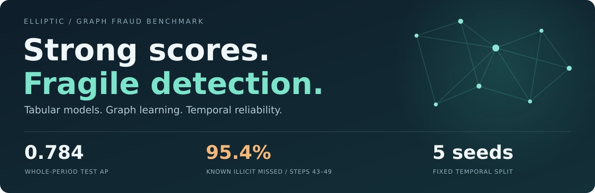
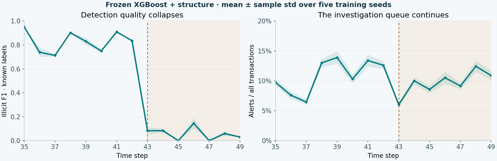

<div align="center">

# Graph-based fraud detection

**Do graph features and GNNs beat a strong tabular model—and does it stay reliable over time?**

[](https://github.com/garvj65/graph-based-fraud-detection/actions/workflows/tests.yml)




[Results](#results) · [Reliability](#reliability-over-time) · [Analyst workload](#the-analyst-workload) · [Method](#method) · [Reproduce](#reproduce) · [Limitations](#limitations)

</div>

An offline fraud/AML benchmark on the Elliptic Bitcoin transaction graph. It compares weighted tabular models, additional NetworkX features, and small PyTorch Geometric GNNs under one chronological evaluation protocol.

> **The finding:** the tested GNNs do not outperform the strong tabular baseline over the full future period. Added structure gives a small ranking gain. The larger concern is temporal reliability: aggregate test performance conceals a severe collapse from step 43 onward.

## Results

**Test steps 35–49 · 16,670 known labels · seeds 0–4.** Mean ± sample standard deviation. AP is sklearn average precision, reported as PR-AUC. Precision, recall, and F1 use each run's validation-selected threshold, frozen before test.

<!-- test-comparison:start -->
| Model | AP / PR-AUC | Precision | Recall | F1 |
|---|---:|---:|---:|---:|
| Logistic Regression · all | 0.1834 ± 0.0000 | 0.1581 ± 0.0000 | 0.9058 ± 0.0000 | 0.2692 ± 0.0000 |
| XGBoost · local | 0.7460 ± 0.0043 | 0.7584 ± 0.1019 | 0.6635 ± 0.0196 | 0.7040 ± 0.0347 |
| XGBoost · all | 0.7805 ± 0.0026 | 0.7584 ± 0.0611 | 0.7186 ± 0.0043 | 0.7368 ± 0.0284 |
| **XGBoost + structure** | 0.7837 ± 0.0035 | 0.7530 ± 0.0343 | 0.7215 ± 0.0066 | 0.7365 ± 0.0140 |
| XGBoost + structure + scores | 0.7802 ± 0.0024 | 0.7230 ± 0.0557 | 0.7202 ± 0.0057 | 0.7206 ± 0.0253 |
| GCN · all | 0.3421 ± 0.0584 | 0.4865 ± 0.1086 | 0.3066 ± 0.0541 | 0.3707 ± 0.0500 |
| GraphSAGE · all | 0.4235 ± 0.0460 | 0.5513 ± 0.0262 | 0.4002 ± 0.0401 | 0.4631 ± 0.0326 |
<!-- test-comparison:end -->

**What this means.** XGBoost remains the strongest family in this comparison. Adding structure changes paired AP by **+0.003255 ± 0.002646**, with **no improvement in mean F1**. That is a small ranking benefit, without an established operating-point or business win.

“All features” already includes 72 supplied neighbor aggregates. The comparison therefore measures the added value of new structure and learned message passing on top of informative inputs. It does not establish that graph information is unhelpful.

The monitored candidate, **XGBoost + structure**, was selected by mean validation AP before test. Seed 0 was predeclared for representative examples. Neither choice was replaced using test results.

[Full comparison and confusion matrices](results/stage5/REPORT.md) · [All 20 variants and ablations](results/stage5/test_summary_all_variants.csv) · [Per-seed metrics](results/stage5/test_per_seed.csv) · [Paired lift](results/stage5/paired_test_lift.csv)

## Reliability over time

A model can rank well over an entire test period while failing during its later snapshots.



For the frozen, validation-selected candidate:

<!-- temporal-comparison:start -->
| Measure | Steps 35–42 | Steps 43–49 |
|---|---:|---:|
| AP / PR-AUC | 0.9084 ± 0.0021 | 0.0431 ± 0.0023 |
| Illicit F1 | 0.8572 ± 0.0072 | 0.0492 ± 0.0084 |
| Illicit recall | 84.6% | 4.6% |
| Alerts / all transactions | 10.8% | 9.3% |
<!-- temporal-comparison:end -->

These are **pooled period metrics**, not averages of time-step F1 or AP. The earlier period contains 914 illicit transactions among 9,983 known labels; the later period contains 169 among 6,687.

**The operational consequence:** in steps 43–49, the policy misses approximately **95.4% of known illicit transactions**, while still flagging **9.3% of all transactions**. Review work continues as known-illicit detection deteriorates.

Observed illicit prevalence also changes, from **9.16% to 2.53%** of known labels. That affects AP's baseline. ROC-AUC falls from **0.969 to 0.692**, and recall falls sharply, providing evidence beyond AP alone. The timing aligns with the [original paper's reported dark-market shutdown](https://arxiv.org/abs/1908.02591); this experiment does not establish causality.

### What the monitoring signals actually tell us

- **Distribution shift:** PSI and KS compare all-node scores with a fixed training reference. The top 10 features are chosen by training-tree gain, with training-only histogram bins.
- **A warning about warnings:** PSI > 0.2 fires in **every validation step/seed comparison**. It signals a distribution difference but does not isolate the later failure. Training-score references are also in-sample.
- **Observed quality:** a three-step pooled F1 rule first warns at **step 44 in all five seeds**. It requires at least 100 known and 20 illicit labels and checks F1 against 80% of validation F1. Actual live warning latency is unknown because label delays are missing.

Drift prompts investigation and targeted labeling. Supported quality deterioration prompts a **retraining review**, followed by a challenger evaluated on a new chronological period and the real investigation budget. No automatic retraining or model promotion is implemented.

[Monitoring report and plots](results/stage6/REPORT.md) · [Per-step CSV](results/stage6/per_step_metrics.csv) / [JSON](results/stage6/per_step_metrics.json) · [Score drift](results/stage6/score_drift.csv) · [Feature drift](results/stage6/feature_drift.csv) · [Warning evidence](results/stage6/warnings.csv)

## The analyst workload

A score becomes useful only when its review burden and label coverage are clear. At the declared benchmark budget of **100 alerts per time step**, the selected model produces:

| All-transaction queue, across the test period | Measured result |
|---|---:|
| Reviews per seed | **1,500** |
| Known illicit transactions found | **390 ± 14** |
| Alerts with unknown labels | **73.2%** |

Unknown alerts have no assigned correctness. **Overall operational precision cannot be measured from this release.**

The separate, retrospective **labeled-only precision@100 is 0.4479 ± 0.0052**. That benchmark filters to known labels before ranking; a live queue cannot do that. Fixed-budget queues rank all scores and are separate from the frozen F1-threshold policy. The 100-alert budget is a declared comparison policy, not a measured staffing requirement.

[Both queue views](results/stage5/budget_summary.csv) · [Validation recall targets transferred to test](results/stage5/recall_policy_transfer.csv) · [Representative all-node queues](results/stage5/representative_operational_queues.csv.gz)

## Method

**203,769 transactions · 234,355 directed payment flows · 49 time steps.** Labels are joined by transaction ID. Unknown nodes remain in their available graph and participate in messages, while their labels are excluded from supervised loss and classification metrics.

| Partition | Time steps | All transactions | Known labels | Known illicit |
|---|---|---:|---:|---:|
| Train | 1–24 | 108,950 | 23,606 | 2,219 |
| Validation | 25–34 | 27,315 | 6,288 | 1,243 |
| Test | 35–49 | 67,504 | 16,670 | 1,083 |

| Model path | Implementation |
|---|---|
| Tabular | Weighted Logistic Regression and XGBoost; local-only and all-feature inputs; training-only scaling and class weights. |
| Additional graph features | Snapshot-local degree, in/out-degree, PageRank, size-adjusted PageRank, and clustering. Neighbor-score mean/max use forward-chained training helpers, frozen after step 24. |
| GNNs | Two-layer GCN and GraphSAGE with 64 hidden channels, weighted masked BCE, validation-AP early stopping, and unique bidirectional message edges. |
| Evaluation and monitoring | Five seeds, saved per-run thresholds, feature/time/structure/message ablations, explicit queue denominators, and training-reference drift. |

The published **94 local / 166 total** convention includes time: 93 numeric local features + time + 72 aggregates. Explicit no-time ablations use 93/165 inputs. Structural-only ablations use six inputs.

There is **no random split or train+validation refit**. Scalers and imbalance weights use known training rows only. Future nodes do not enter training messages. Structural computations on held-out data use each observed completed snapshot, without fitting a global future graph. Decisions use `score >= threshold`; the threshold maximizes validation illicit F1, with higher thresholds winning ties.

<details>
<summary><strong>Protocol details and audit trail</strong></summary>

- [Data integrity and split counts](results/stage1/data_audit.json)
- [Graph-feature definitions and validation comparison](results/stage3/REPORT.md)
- [GNN training and checkpoint protocol](docs/stage4_protocol.md)
- [Frozen-model evaluation protocol](docs/stage5_protocol.md) and [independent audit](results/stage5/independent_validation.json)
- [Monitoring protocol](docs/stage6_protocol.md) and [independent audit](results/stage6/independent_validation.json)
- [Final technical/code review](docs/final_review.md), [numerical replay evidence](results/final_review/numerical_replay.json), and [five interview findings](docs/project_findings.md)
- [Recorded environment versions](docs/environments/README.md) and [earlier development notes](docs/history/README.md)

Run records retain configs, seeds, dependency versions, artifact/input hashes, and metrics. Historical recovery and interrupted-run evidence are preserved. Five-seed standard deviation describes fitting variation on this dataset, not uncertainty across future time periods. Logistic Regression is deterministic, so its repeated seeds add no independent variation.

</details>

## Reproduce

The committed results and reports can be inspected without downloading data or training models. To regenerate the complete benchmark, use **Python 3.10+**; the recorded CPU experiment used **Python 3.12**.

```bash
git clone https://github.com/garvj65/graph-based-fraud-detection.git
cd graph-based-fraud-detection
python -m venv .venv
source .venv/bin/activate

python -m pip install torch==2.8.0 --index-url https://download.pytorch.org/whl/cpu
python -m pip install -r requirements-gnn.txt -r requirements-dev.txt

# Run serially: later targets consume earlier models and manifests.
make -j1 stage1 stage2 stage3 stage4 stage5 stage6
```

CPU training is supported; a GPU is not required. Raw data, weights, and full score arrays are excluded from Git and regenerated under `data/` and `artifacts/`. A fresh checkout must run the earlier targets before final evaluation or monitoring. The raw feature CSV alone is approximately 690 MB; allow additional disk and parsing memory.

For a quick code check without downloading the dataset:

```bash
python -m pytest -q
python -m ruff check .
```

CI tests Python 3.10 and 3.12 with and without the GNN stack, using synthetic fixtures. **127 tests passed with the full stack at the reviewed implementation checkpoint.** Recorded direct versions, individual commands, Windows setup, and exact-replay limits are in the [reproduction guide](docs/reproduction.md).

### Find your way around

| Location | Purpose |
|---|---|
| [`src/data.py`](src/data.py), [`src/features.py`](src/features.py) | Dataset contracts, temporal masks, available graphs, and feature construction. |
| [`src/models.py`](src/models.py), [`src/gnn.py`](src/gnn.py) | Weighted tabular estimators and small GNNs. |
| [`src/train.py`](src/train.py), [`src/final_evaluate.py`](src/final_evaluate.py) | Training CLI and frozen-model test evaluation. |
| [`src/monitor.py`](src/monitor.py) | Per-step performance, drift references, and warning policies. |
| [`configs/`](configs), [`tests/`](tests) | Experiment policies and correctness/leakage tests. |
| [`results/`](results), [`docs/`](docs), [`notebooks/01_eda.ipynb`](notebooks/01_eda.ipynb) | Measured evidence, protocol/review notes, and a thin EDA view. |

## Limitations

- **Sparse, selective labels.** Approximately 77% of transactions are unknown. Known-label metrics do not establish population fraud prevalence or operational precision. Some test snapshots contain very few known illicit transactions.
- **Retrospective availability.** Supplied aggregates include forward-neighbor information. Completed snapshots do not establish transaction-arrival availability; upstream normalization and actual label delays cannot be reconstructed.
- **Temporal proxies remain.** Three important aggregates correlate strongly with training time. Removing the explicit time column does not establish that implicit temporal information has been removed.
- **One historical comparison.** Validation is reused for settings, checkpoints, and cutoffs. Small architectures, a limited tuning budget, and bidirectional message passing constrain the GNN conclusion. Seed variation is not temporal confidence.
- **Numerical portability.** The refreshed runtime reproduced all 60 tabular combinations bitwise, while 40 GNN combinations showed small rounding differences. The maximum score difference was about 0.0000021; no frozen-threshold decisions or top-100 memberships changed. The original strict replay failure is [documented](docs/final_review.md#exact-score-replay-and-numerical-portability), and the original scores remain canonical.
- **Offline scope.** Scores are uncalibrated. There is no real-time deployment, production feedback loop, analyst trial, proven financial benefit, or validated automatic retraining policy.

## Data and references

Dataset credit: **Elliptic**, introduced by [Weber et al., *Anti-Money Laundering in Bitcoin* (2019)](https://arxiv.org/abs/1908.02591). The benchmark uses the raw CSV release; a PyG acquisition adapter is also available, with temporal masks rebuilt from raw time steps.

[Original dataset](https://www.kaggle.com/datasets/ellipticco/elliptic-data-set) · [PyG dataset implementation](https://pytorch-geometric.readthedocs.io/en/latest/_modules/torch_geometric/datasets/elliptic.html)
