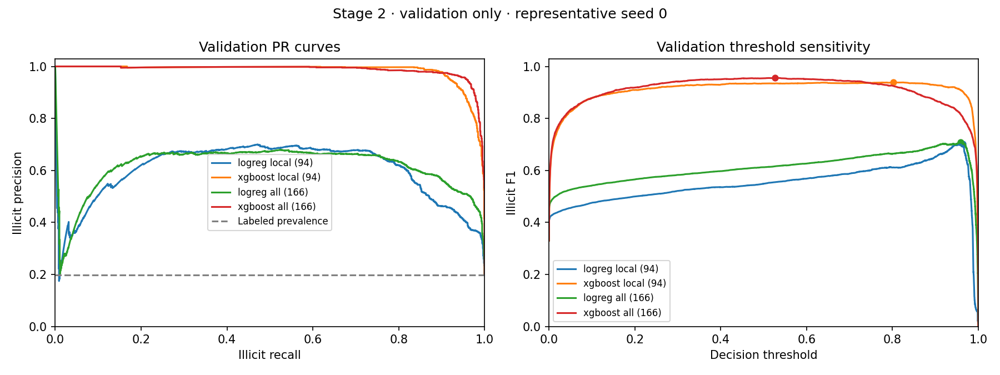
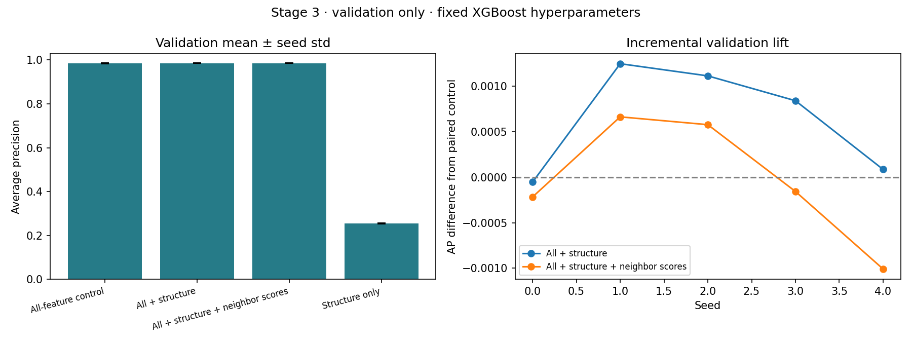
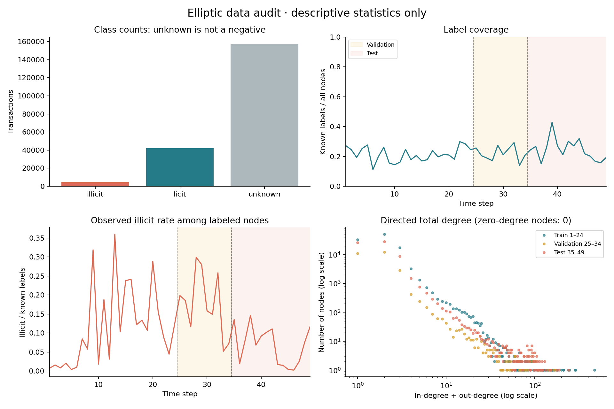

# Graph-based illicit transaction detection on Elliptic

**Question:** Do additional graph features and small GNNs improve on a strong
tabular baseline, and does the model remain reliable over time?

**Status: Stages 1–3 complete; Stage 4 GNN experiment in progress.**
The dataset, temporal splits, weighted tabular baselines and additional graph
features have real five-seed validation results. Final test evaluation and
over-time monitoring remain future review stages.

This is an offline benchmark for an Associate Data Scientist portfolio. It is
not a real-time fraud service or a claim of deployment experience.

## Reproduce stages 1–4

Python 3.10+; the completed run used Python 3.12.14. No GPU is required.
From the repository root:

```bash
python -m venv .venv
source .venv/bin/activate
python -m pip install -r requirements.txt
make stage1
```

`make stage1` runs the tests, downloads the three raw CSVs from the public PyG
mirror if needed, validates the full dataset, and regenerates the audit and EDA.
On Windows, use `.venv\Scripts\activate` and run these commands instead of Make:

```bash
python -m pytest -q
python -m src.data --config configs/default.yaml --download
```

Run the complete baseline experiment (tests, optional data acquisition, then
candidate selection and five-seed replications):

```bash
make stage2
# Equivalent training CLI:
python -m src.train --config configs/stage2.yaml --download
# A smaller run; its summary explicitly shows fewer than five seeds:
python -m src.train --model xgboost --seed 0 --output-dir results/stage2_seed0
```

The full default experiment performs 56 fits: 24 tuning trials plus 32 new
replications, reusing eight selected seed-0 tuning fits for 40 selected seed
results. Logistic regression uses balanced class weights and a training-only
StandardScaler; XGBoost uses a training-only positive-class weight ratio and
600 histogram-based trees, with no validation data passed to estimator fitting.
Three predeclared candidates are compared per family/feature variant on fixed
seed 0; the winning candidate is frozen for all five seeds. No best-seed choice,
SMOTE, random temporal split, or train+validation refit is performed.

Models and exact validation score arrays are saved under ignored `artifacts/`;
committed run logs contain their hashes, parameters, seeds, versions and frozen
thresholds. Run the command to regenerate those binaries. The representative
seed-0 validation score evidence is committed as compressed CSV; use pandas
`read_csv(..., float_precision="round_trip")` when reproducing threshold ties.
`requirements-stage2-tested.txt` records the observed direct versions. These are
not transitive locks; exact floating-point results can vary across dependency
versions and hardware. CI tests correctness rather than cross-platform bitwise
identity.

Run Stage 3 from one command:

```bash
make stage3
# Equivalent training CLI:
python -m src.graph_train --config configs/stage3.yaml --download
```

This uses the committed Stage 2 selection/run metadata; Stage 2 binary artifacts
are not required. It rebuilds snapshot-local features and performs 20 downstream
XGBoost fits (four variants × five seeds), using the previously selected Stage 2
hyperparameters unchanged. It also fits 24 deterministic forward-chained score
helpers and logs one cold-start fallback. Neither model hyperparameters nor
helper settings are retuned on Stage 3 results. `requirements-stage3-tested.txt`
records the observed direct versions.

All models, feature arrays and exact score arrays live under ignored
`artifacts/`. Committed per-fit logs, feature/cutoff audits, representative score
CSV, tables and plots retain the experiment evidence. Reproduction regenerates
the binary artifacts. Test graph rows remain unavailable (NaN) during this stage.

For Stage 4, install the CPU Torch wheel and PyG, then run the complete GNN
experiment, tests and independent checkpoint/metric validation:

```bash
python -m pip install torch==2.8.0 --index-url https://download.pytorch.org/whl/cpu
python -m pip install -r requirements-gnn.txt
make stage4
# Individual architecture / seed:
python -m src.train --model gcn --seed 0 --output-dir results/stage4_gcn_seed0
```

The default uses two-layer GCN and GraphSAGE models on local, all and six
structure-only inputs. A no-message control for each architecture reuses the
selected all-feature parameters. Two predeclared candidates are compared on
seed 0 per architecture/input group; winners are frozen for seeds 0–4. The
complete run requires 46 unique fits and produces 40 selected seed results.
The default CPU run uses four Torch threads, 64 hidden channels, at most 250
epochs and validation-AP early stopping with patience 30. Scores, thresholds,
best epochs and every effective config are logged. Detailed choices and
leakage controls are in [the Stage 4 protocol](docs/stage4_protocol.md).

Weights, scalers and full validation scores are regenerated under ignored
`artifacts/`. Run logs, epoch histories, representative scores, tables and plots
are committed. `scripts/validate_stage4.py` reloads checkpoints and independently
recomputes AP and thresholds without scoring test data. A single-seed run has
unavailable std. CUDA is an optional separately configured experiment; the
completed benchmark uses CPU. `requirements-stage4-tested.txt` records direct
observed versions, not a transitive lock or cross-platform identity guarantee.

The raw feature CSV is about 690 MB; allow space for raw files, temporary ZIPs
and parsing memory. Raw data is excluded from version control.
The CSV layout is the same as the original Kaggle release. Kaggle downloads can
be supplied with:

```bash
python -m src.data --raw-dir /path/to/elliptic_bitcoin_dataset
```

The requested PyG acquisition route is also implemented:

```bash
python -m pip install -r requirements-gnn.txt
python -m src.data --source pyg
```

PyG dataset acquisition was not exercised; full-data loading uses the audited
raw CSV route. Stage 4 exercises PyG's GCN and GraphSAGE training layers. PyG's
processed feature matrix omits time, and its default training mask uses steps
1–34. This project ignores those masks, recovers time from the raw CSV and joins
labels by transaction ID, rather than trusting CSV row-order alignment.

`requirements-stage1-tested.txt` records the direct package versions used for
the completed run on Python 3.12; it is not a cross-platform or transitive lock.
GitHub Actions is configured for Python 3.10 and 3.12, using small synthetic test
fixtures without a network/data download. Consult the repository's
[Actions tab](https://github.com/garvj65/graph-based-fraud-detection/actions)
for hosted CI status; the local verification is saved with this checkpoint.

## Stage 2 baseline comparison — validation only

**Steps 25–34; known labels only. These are not test results.** Mean ± sample
standard deviation over seeds 0–4. AP is sklearn average precision; trapezoidal
PR-AUC is recorded separately in the CSV. Precision, recall and F1 use each
seed's validation-selected maximum-F1 threshold, with higher thresholds winning
ties. Individual thresholds are frozen in run JSONs; their summary mean is not
used as a replacement decision threshold.

| Model | Inputs | Features | Seeds | AP (PR-AUC) | Precision | Recall | F1 |
|---|---|---:|---:|---:|---:|---:|---:|
| LogReg | all | 166 | 5 | 0.6115 ± 0.0000 | 0.6327 ± 0.0000 | 0.8053 ± 0.0000 | 0.7087 ± 0.0000 |
| LogReg | local | 94 | 5 | 0.5944 ± 0.0000 | 0.6730 ± 0.0000 | 0.7353 ± 0.0000 | 0.7028 ± 0.0000 |
| XGBoost | all | 166 | 5 | 0.9853 ± 0.0018 | 0.9533 ± 0.0109 | 0.9514 ± 0.0046 | 0.9523 ± 0.0065 |
| XGBoost | local | 94 | 5 | 0.9829 ± 0.0005 | 0.9611 ± 0.0169 | 0.9176 ± 0.0176 | 0.9386 ± 0.0013 |

Validation selects both candidates and thresholds, so these development scores
are optimistic. Test performance stays unevaluated until Stage 5. Additional graph features are compared in Stage 3 below; GNN results are reported separately in Stage 4.



See [the full Stage 2 report](results/stage2/REPORT.md) for the no-time ablation,
[per-seed metrics](results/stage2/validation_per_seed.csv),
[candidate trials](results/stage2/tuning_candidates.csv),
[independent validation](results/stage2/independent_validation.json), and
[the Stage 1 correctness review](docs/stage1_review.md).

## Stage 3 graph comparison — validation only

Mean ± sample std over the same five seeds; each model has a validation-only
frozen threshold. The fresh control reproduces Stage 2 inputs, validation
scores, metrics and thresholds exactly for all five seeds.

| Model | Features | AP (PR-AUC) | Illicit F1 |
|---|---:|---:|---:|
| XGBoost control | 166 | 0.98535 ± 0.00180 | 0.95235 ± 0.00645 |
| XGBoost + structure | 172 | 0.98599 ± 0.00139 | 0.95362 ± 0.00607 |
| XGBoost + structure + neighbor scores | 174 | 0.98532 ± 0.00137 | 0.95118 ± 0.00512 |
| XGBoost structure only | 6 | 0.25526 ± 0.00205 | 0.38044 ± 0.00380 |

Structure adds a small validation AP difference of +0.000647 ± 0.000596 across paired seeds (4/5 positive). The combined structure/neighbor-score variant differs from control by -0.000028 ± 0.000682 (2/5 positive). The simple neighbor scores add no validation gain in this experiment. The final test comparison remains pending; Stage 4 adds the GNN experiment.



The six structural inputs are degree, in-degree, out-degree, directed PageRank,
snapshot-size-adjusted PageRank and clustering on an undirected projection.
Every calculation uses one observed completed snapshot. Validation graph
statistics are deterministic inference transforms on its unlabeled topology;
no model, scaler, class weight, histogram bin or graph normalization is fitted
across validation/test periods. No test graph statistics are computed here.

The two neighbor-score inputs are mean/max over unique incoming/outgoing
neighbors. A fixed balanced LogReg on local numeric inputs produces each
training step's scores using **earlier training steps only**. Steps 25–34 use a
single frozen score helper trained on steps 1–24. Unknown nodes receive scores
and remain in aggregation. Raw neighbor labels are excluded from model inputs:
validation nodes have zero neighbors whose labels are exposed by the training
period. The audit records this availability gap explicitly.

The score helper uses no time input, fits its scaler only on eligible known
training rows, and is not tuned on validation. Insufficient-history cases use a
configured fixed score of 0.5; isolates use zero for empty neighbor aggregates.
Past labels are assumed available by the next time step because actual label
availability timestamps are absent. Changing helper training sizes and absent
label-delay information limit the operational interpretation.

See [the Stage 3 report](results/stage3/REPORT.md),
[paired per-seed lift](results/stage3/paired_lift.csv),
[feature and score-helper audit](results/stage3/graph_feature_manifest.json),
[independent validation](results/stage3/independent_validation.json), and
[five interview findings](docs/stage3_findings.md).
The representative seed-0 gain importances use training trees only; they are
recorded as split-gain diagnostics, with no causal attribution claim.

## Fixed temporal protocol

Inclusive boundaries are enforced in code and configuration. There is no random
split and no temporal shuffling. Counts below come from the completed raw-data
audit at `results/stage1/data_audit.json`.

| Split | Time steps | All nodes | Labeled nodes | Illicit | Licit | Unknown |
|---|---|---:|---:|---:|---:|---:|
| Train | 1–24 | 108,950 | 23,606 | 2,219 | 21,387 | 85,344 |
| Validation | 25–34 | 27,315 | 6,288 | 1,243 | 5,045 | 21,027 |
| Test | 35–49 | 67,504 | 16,670 | 1,083 | 15,587 | 50,834 |

Internal labels are `1=illicit`, `0=licit`, `-1=unknown`. The raw CSV uses
`1=illicit`, `2=licit`, `unknown=unlabeled`. Unknown nodes remain in their
available graph, but never enter supervised masks. Future-period unknown nodes
are not available to the training graph.

The audit found 203,769 nodes, 234,355 directed edges, 49 time steps, zero
cross-time edges, zero duplicate directed edges and zero self-loops. The
training graph retains all 108,950 training-period nodes and 127,488 edges.

### The 166-feature counting detail

The published 94 local features **include the time step**. The CSV therefore
contains ID, time, 93 local numeric features, and 72 aggregate numeric features.
PyG returns 165 predictors. The project stores time separately and supports both
93/165-feature and 94/166-feature matrices, with an explicit `include_time`
argument. Stage 2 follows the original 94/166 convention, including time, and
also runs the 93/165 no-time ablation.

The all-feature tree baseline already includes supplied graph-derived neighbor
aggregates. It is a tabular model, but cannot be described as having no graph
information. Later comparisons must distinguish supplied aggregates, newly
computed graph features, and learned message passing.

## Stage 1 EDA



The observed illicit rate uses **illicit / known labels**. It is not the
population fraud rate: unknown nodes have no negative label. The CSV includes
label coverage and the known-illicit share of all nodes under separate names.
Full-period plots are descriptive and must not be used to tune models or
thresholds. The test period remains unused for model selection.

Degree in this figure means in-degree + out-degree in the raw directed graph.
It is descriptive EDA, not a feature fitted on the complete graph for training.
The notebook is a thin view over the same code and saved evidence, with no
independent preprocessing or split implementation.

## Leakage risks and defenses

| Risk | Defense / remaining limitation |
|---|---|
| PyG train mask accidentally includes validation | Rebuild all masks from raw timestamps; reject any departure from 1–24 / 25–34 / 35–49. |
| Labels silently attached to the wrong transactions | Join by ID; reject duplicate/missing IDs, invalid classes and missing edge endpoints. |
| Unknown interpreted as licit | Use `-1` and separate graph/supervision masks; test every split. |
| Future nodes affect training messages or normalization | Training graph is induced on steps 1–24; snapshot API exposes one time step only. Unknown future nodes are excluded from training too. |
| Neighbor-label leakage | Helper exposes train labels only; validation/test labels are replaced by unknown. Stage 3 uses forward-chained model scores rather than raw neighbor labels; Stage 4 never uses labels as features. |
| Label-derived features fail outside training | There are no cross-time edges. The audit finds zero evaluation edges touching train-labeled nodes. A train-label-only neighbor feature has no labeled neighbors in validation/test; do not claim useful holdout coverage. |
| Supplied aggregates use forward neighbors | These are retrospective one-hop aggregates. Completed-snapshot versus transaction-arrival availability must be agreed before modeling. The anonymized release cannot certify strict as-of feature availability or reconstruct precise arrival order. |
| Preprocessing fitted on validation/test | None is fitted in stage 1. Later scalers, class weights, feature selection and drift reference/bin edges must use training data only. |
| Operational precision overstated despite sparse labels | Keep label coverage visible; unknown alerts cannot be assigned correctness. Labeled-only top-k precision and an all-node alert queue answer different questions. |
| Test-guided choices | Use validation only for early stopping, hyperparameters, threshold and model selection. Freeze them before final test evaluation. |

PageRank, clustering and other structural values on a new observed snapshot
are inference-time computations, not permission to estimate a global graph
using future steps. Stages 3 and 4 document this distinction for graph features and message normalization.

## Evidence and reproducibility

Each stage-1 invocation writes a run JSON with its effective configuration,
package versions, raw-file SHA-256 hashes, source-file hashes, audit output and
status. Failures after config parsing also leave a failure record. Seed is
`null` because stage 1 has no stochastic model fitting; seeds 0–4 are reserved
in config for later experiments. No placeholder model metric is emitted.

Use `results/stage1/latest_run.json` for the current successful run. One early
audit run is explicitly marked `invalidated`: its duplicate-edge counter used
the wrong array dimension. The bug was fixed, a regression assertion added,
and the full-data audit rerun. Its numbers are not current results.

Outputs:

- `results/stage1/data_audit.json`: split, class and graph integrity checks.
- `results/stage1/split_summary.csv`: all-node and labeled counts per split.
- `results/stage1/label_coverage_by_step.csv`: descriptive counts and rates.
- `results/stage1/figures/data_overview.png`: one four-panel EDA figure.
- `results/stage1/runs/`: per-run evidence, including failure/invalidation status.
- `results/stage1/verification.txt`: completed local test/lint verification.
- `docs/stage1_findings.md`: five interview-style data/protocol findings.

Tests cover exact boundaries and ordering, unknown-label exclusion, row-order
independence, future-input invariance, graph membership, invalid schema/edges,
rate denominators, and successful/failed CLI logging. They use explicitly
synthetic fixtures; dataset findings use only the downloaded real release.

## Remaining review stages

1. **Data + splits + tests:** reviewed and validated; timestamp precision guard fixed.
2. **Baselines:** complete; weighted LogReg/XGBoost, local/all and time ablations,
   five-seed validation results and frozen thresholds. Reviewed.
3. **Graph features:** complete; NetworkX structure, forward-chained neighbor
   scores, paired five-seed comparisons and structure-only ablation. Reviewed.
4. **GNNs:** in progress; small GCN and GraphSAGE, weighted supervised loss,
   training-period message passing, validation early stopping, five seeds.
5. **Evaluation:** fixed validation-selected thresholds; AP primary, trapezoidal
   PR-AUC separate; precision/recall/F1, confusion matrix, top-k and secondary ROC-AUC;
   mean ± sample std, paired seed differences and feature/structure ablations.
6. **Monitoring:** frozen-model per-step test metrics, alert rates and score
   distributions; train-reference PSI/KS and top-10 feature drift. Investigate
   the reported step-43 regime change without asserting it causes measured
   decay. Propose triggers with training/validation justification and label-delay
   assumptions. Emit plots, JSON/CSV and five final interview findings.

Stages 5–6 are not implemented in this checkpoint. Final test and monitoring
claims will be added only after their actual runs. Explainability,
communities, semi-supervised experiments and a dashboard follow the core
comparison if time permits.

## Explicit protocol choices

`configs/default.yaml` preserves the historical Stage 1 checkpoint, which had no
modeling policy. `configs/stage2.yaml` contains the baseline protocol; `configs/stage3.yaml`
preserves its split/metrics and fixes the additional graph experiment.
`configs/stage4.yaml` preserves the same split, AP definition, time-feature
convention and validation-max-F1 threshold policy for the GNN comparison.
After the choice form returned no selections, Stage 2 used explicit defaults:

- Primary inputs: 94 local / 166 all features, including time; 93/165 run as an
  ablation. The primary convention is not changed after seeing the ablation.
- Availability: completed snapshots; supplied forward-neighbor and label-delay
  limitations remain explicit. This is not a transaction-arrival replay.
- Selection metric: average precision, labeled **AP (PR-AUC)**; trapezoidal
  PR-AUC is reported separately.
- Threshold: maximize validation illicit F1; tie within numerical tolerance goes
  to the higher threshold; prediction rule is `score >= threshold`.
- Test performance: deferred until Stage 5. No test score was consulted here.
- Alert budget and operational top-k denominator: still pending. Unknown alerts
  cannot be called false positives or true positives without additional labels.

## Limitations

Most labels are unknown, and observed labels need not be representative or
available promptly. Label availability times are absent. Ground truth is an
entity-derived heuristic classification, not a proof that a transaction is a
crime. Features are anonymized and partly retrospective, constraining
explanation and strict causal replay. Temporal label/prevalence shift can affect
PR metrics independently of model deterioration. Five seeds quantify training
variability, not uncertainty over unseen time periods. LBFGS is deterministic,
so LogReg's repeated seeds provide no extra independent evidence. The candidate
grid is small and not an exhaustive tuning exercise; the chosen LogReg C lies
at its upper boundary. Upstream feature preprocessing and strict as-of
availability cannot be independently reconstructed from the release. This is one historical
dataset with no real-time deployment, production feedback, or analyst review.

## Primary references

- [Original paper and dataset description](https://arxiv.org/abs/1908.02591)
- [PyG EllipticBitcoinDataset implementation](https://pytorch-geometric.readthedocs.io/en/latest/_modules/torch_geometric/datasets/elliptic.html)
- [Original Kaggle release](https://www.kaggle.com/datasets/ellipticco/elliptic-data-set)

- [scikit-learn average precision definition](https://scikit-learn.org/stable/modules/generated/sklearn.metrics.average_precision_score.html)
- [XGBoost parameters](https://xgboost.readthedocs.io/en/stable/parameter.html)

- [NetworkX PageRank](https://networkx.org/documentation/stable/reference/algorithms/generated/networkx.algorithms.link_analysis.pagerank_alg.pagerank.html)
- [NetworkX clustering](https://networkx.org/documentation/stable/reference/algorithms/generated/networkx.algorithms.cluster.clustering.html)
