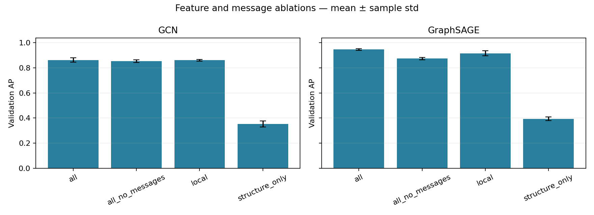
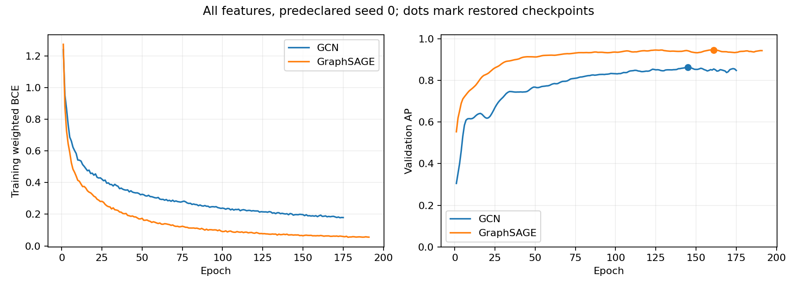

# Stage 4 — GCN and GraphSAGE

**Validation only, known labels in steps 25–34. Test remains unevaluated.**

## Comparison with earlier stages

| Model | Inputs | Features | Seeds | AP (PR-AUC) | Precision | Recall | F1 |
|---|---|---:|---:|---:|---:|---:|---:|
| LogReg | all | 166 | 5 | 0.6115 ± 0.0000 | 0.6327 ± 0.0000 | 0.8053 ± 0.0000 | 0.7087 ± 0.0000 |
| XGBoost | all | 166 | 5 | 0.9853 ± 0.0018 | 0.9533 ± 0.0109 | 0.9514 ± 0.0046 | 0.9523 ± 0.0065 |
| XGBoost | local | 94 | 5 | 0.9829 ± 0.0005 | 0.9611 ± 0.0169 | 0.9176 ± 0.0176 | 0.9386 ± 0.0013 |
| XGBoost | all_graph | 174 | 5 | 0.9853 ± 0.0014 | 0.9501 ± 0.0126 | 0.9524 ± 0.0049 | 0.9512 ± 0.0051 |
| XGBoost | all_structure | 172 | 5 | 0.9860 ± 0.0014 | 0.9574 ± 0.0053 | 0.9500 ± 0.0117 | 0.9536 ± 0.0061 |
| GCN | all | 166 | 5 | 0.8622 ± 0.0172 | 0.7831 ± 0.0184 | 0.8290 ± 0.0147 | 0.8052 ± 0.0099 |
| GraphSAGE | all | 166 | 5 | 0.9467 ± 0.0066 | 0.8934 ± 0.0167 | 0.8755 ± 0.0150 | 0.8841 ± 0.0077 |

## GNN feature and message ablations

| Model | Inputs | Features | Seeds | AP (PR-AUC) | Precision | Recall | F1 |
|---|---|---:|---:|---:|---:|---:|---:|
| GCN | all | 166 | 5 | 0.8622 ± 0.0172 | 0.7831 ± 0.0184 | 0.8290 ± 0.0147 | 0.8052 ± 0.0099 |
| GCN | all_no_messages | 166 | 5 | 0.8539 ± 0.0103 | 0.8207 ± 0.0125 | 0.8706 ± 0.0339 | 0.8445 ± 0.0140 |
| GCN | local | 94 | 5 | 0.8607 ± 0.0079 | 0.7754 ± 0.0166 | 0.8027 ± 0.0198 | 0.7886 ± 0.0067 |
| GCN | structure_only | 6 | 5 | 0.3538 ± 0.0237 | 0.2550 ± 0.0158 | 0.9258 ± 0.0269 | 0.3994 ± 0.0172 |
| GraphSAGE | all | 166 | 5 | 0.9467 ± 0.0066 | 0.8934 ± 0.0167 | 0.8755 ± 0.0150 | 0.8841 ± 0.0077 |
| GraphSAGE | all_no_messages | 166 | 5 | 0.8743 ± 0.0099 | 0.8579 ± 0.0099 | 0.8674 ± 0.0112 | 0.8626 ± 0.0069 |
| GraphSAGE | local | 94 | 5 | 0.9164 ± 0.0202 | 0.8304 ± 0.0468 | 0.8656 ± 0.0204 | 0.8470 ± 0.0252 |
| GraphSAGE | structure_only | 6 | 5 | 0.3935 ± 0.0149 | 0.3092 ± 0.0456 | 0.6858 ± 0.2086 | 0.4122 ± 0.0100 |

## Training and selection

Two message-passing layers, ReLU and dropout; GCN uses normalized self-loops, GraphSAGE uses mean neighbor aggregation with a separate root transformation. Raw edges are made bidirectional and deduplicated within each snapshot. Payment direction is not preserved by messages. GCN adjacency caching is disabled because training and validation use different graphs. No batch normalization or globally learned graph normalization is used.

The scaler fits known training rows only and transforms all available nodes. Unknown nodes participate in messages but never in loss, early stopping or metrics. Weighted BCE derives its positive weight from known training labels only. Full-batch updates use the disjoint training snapshots 1–24; validation graphs 25–34 are separate, evaluated without gradients or dropout.

Each architecture/feature group compares 2 predeclared candidates on seed 0. The selected candidate is frozen for seed replications, reusing its tuning-seed fit. Early stopping maximizes validation AP, exact ties keeping the earliest epoch. After restoring that checkpoint, each run selects its maximum-F1 validation threshold, ties favoring the higher threshold. No best-seed choice, test tuning, or train+validation refit occurs. Exact settings are in config and every run JSON.

Structure-only inputs are the six snapshot-local NetworkX features from Stage 3; there are no transaction attributes or time input in this ablation. The all_no_messages control removes every inter-node edge and uses the selected all-feature hyperparameters without a separate search. GCN still has self-loops; GraphSAGE retains its root transformation. Controls select epochs/thresholds independently on validation. They test the implemented message contribution, not every possible neural architecture.

Actual unique fits: 46; selected seed results: 40. Mean ± sample std, ddof=1; single-seed invocations have unavailable std. The representative diagnostic seed is predeclared, not the best seed.

## Limits

Validation selects settings, epochs and thresholds, so these are optimistic development estimates. The search is deliberately small. Seed variability is not a confidence interval or evidence of temporal stability. Differences between architectures also reflect optimization and feature choices; graph learning is not isolated by comparing a GNN to a tree alone. The no-message control helps address that narrower question.

All-feature inputs already contain supplied neighbor aggregates. Completed snapshots and supplied forward-neighbor aggregates do not demonstrate transaction-arrival availability. Label timestamps are unavailable. Unknown alerts cannot be judged correct/incorrect. Scores are uncalibrated. Test comparisons and monitoring remain later review stages.

<!-- stage4-measured-start -->
## Measured interpretation

Neither primary GNN demonstrates a mean validation AP advantage over the strongest tabular result under this compute and tuning budget.

The best primary GNN mean AP differs from the strongest tabular mean by -0.03934. Candidate and epoch selection used validation; these comparisons are descriptive, not significance tests.

| Architecture | AP change, messages − no messages | Positive seeds |
|---|---:|---:|
| gcn | +0.00825 ± 0.02276 | 2/5 |
| graphsage | +0.07234 ± 0.01312 | 5/5 |

The controls share all-feature hyperparameters but select their own validation checkpoint and threshold. Differences concern these implementations and do not isolate every architecture or optimization effect.

There were 46 completed fits. Interrupted attempts excluded from metrics: 1. Completed artifacts were preserved during resumption. 2/40 selected fits reached the configured epoch cap; 2 of those had their best epoch in the final patience window. Convergence is therefore not established for every fit. The declared budget was not expanded after seeing the results. See `budget_audit.csv` for all candidates. Test performance and over-time reliability remain unevaluated.
<!-- stage4-measured-end -->
