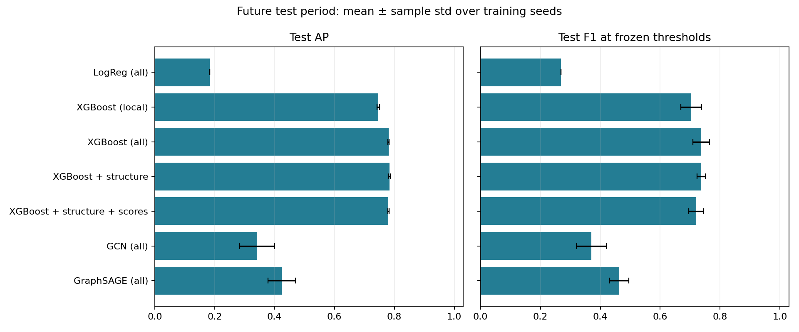
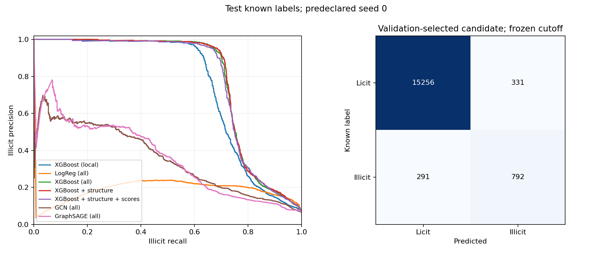
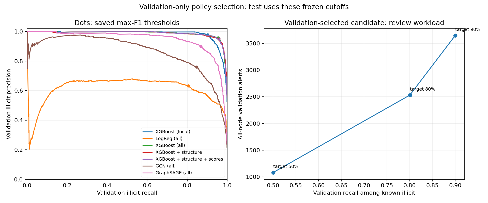

# Stage 5 — frozen-model temporal test evaluation

**Test steps 35–49. Unknown labels are excluded from classification metrics.**

## Main comparison

| Model | Seeds | AP (PR-AUC) | Illicit precision | Illicit recall | Illicit F1 |
|---|---:|---:|---:|---:|---:|
| LogReg (all) | 5 | 0.1834 ± 0.0000 | 0.1581 ± 0.0000 | 0.9058 ± 0.0000 | 0.2692 ± 0.0000 |
| XGBoost (local) | 5 | 0.7460 ± 0.0043 | 0.7584 ± 0.1019 | 0.6635 ± 0.0196 | 0.7040 ± 0.0347 |
| XGBoost (all) | 5 | 0.7805 ± 0.0026 | 0.7584 ± 0.0611 | 0.7186 ± 0.0043 | 0.7368 ± 0.0284 |
| XGBoost + structure | 5 | 0.7837 ± 0.0035 | 0.7530 ± 0.0343 | 0.7215 ± 0.0066 | 0.7365 ± 0.0140 |
| XGBoost + structure + scores | 5 | 0.7802 ± 0.0024 | 0.7230 ± 0.0557 | 0.7202 ± 0.0057 | 0.7206 ± 0.0253 |
| GCN (all) | 5 | 0.3421 ± 0.0584 | 0.4865 ± 0.1086 | 0.3066 ± 0.0541 | 0.3707 ± 0.0500 |
| GraphSAGE (all) | 5 | 0.4235 ± 0.0460 | 0.5513 ± 0.0262 | 0.4002 ± 0.0401 | 0.4631 ± 0.0326 |

AP is sklearn average precision; trapezoidal PR-AUC and secondary ROC-AUC are separate columns in the CSV. Each metric uses the same known test transactions. Mean ± sample std over the declared training seeds; no best-seed selection.

The pre-test validation-selected variant was **XGBoost + structure**. It remains the selected candidate regardless of test ranking. Every model, scaler, hyperparameter, primary cutoff, tie rule and alert budget was frozen before test scoring. No model/helper/preprocessor was fitted in this stage.

## Alert budget: two different questions

The declared budget is up to **100 alerts per time step**. The choice form returned no selections; this explicit benchmark default was recorded before test scoring. It is not a measured staffing requirement. These queues rank scores and are separate from the fixed-F1-threshold alerts. Ties use lexical transaction ID, never labels.

| Model | Labeled-only precision@k | Known illicit in all-node queue | Unknown share in queue |
|---|---:|---:|---:|
| LogReg (all) | 0.2047 ± 0.0000 | 36.0000 ± 0.0000 | 82.7% |
| XGBoost (local) | 0.4147 ± 0.0031 | 356.6000 ± 13.8492 | 75.3% |
| XGBoost (all) | 0.4440 ± 0.0043 | 382.6000 ± 7.1274 | 73.7% |
| XGBoost + structure | 0.4479 ± 0.0052 | 390.0000 ± 14.0000 | 73.2% |
| XGBoost + structure + scores | 0.4491 ± 0.0034 | 385.4000 ± 3.5071 | 73.4% |
| GCN (all) | 0.2743 ± 0.0328 | 117.6000 ± 38.5071 | 80.8% |
| GraphSAGE (all) | 0.2917 ± 0.0162 | 188.0000 ± 10.4403 | 78.7% |

Labeled-only precision@k filters to known labels before ranking. It is a retrospective benchmark, not an operational queue. All-node queues rank every transaction and report known illicit/licit counts, unknown counts and label coverage. Their overall precision cannot be measured from this release. Unknown alerts are never false positives. Counts are totals over test steps, averaged over seeds; they are not sums of distinct cases across repeated seeds. Labeled precision@k is micro-aggregated from selected labeled alerts, with k capped by cohort size.

## Frozen thresholds and recall targets

Primary precision/recall/F1 use each historical run's saved validation-max-F1 cutoff. No cutoff is optimized on test. Additional recall targets are diagnostics: the highest validation cutoff meeting each declared target is frozen and transferred to test. `recall_policy_transfer.csv` shows achieved recall and all-node alert workload in both periods. A validation recall target is not a test recall guarantee.

## Ablations and evidence

`test_summary_all_variants.csv` retains local/all, time/no-time, structure-only and no-message controls from earlier stages. `paired_test_lift.csv` subtracts the same seed's all-feature XGBoost result. Paired differences are descriptive; five seeds do not create five independent datasets or a significance test.

All per-seed confusion matrices, frozen-threshold workloads, budget queues and recall policies have CSV evidence. The representative seed is predeclared. Exact full-node scores live under ignored `artifacts/`; committed compressed CSVs retain known-label test scores and all-node queue evidence for primary seed 0. Use pandas `float_precision='round_trip'` to preserve score/threshold ties.

## Limits and next review

Validation was reused for settings, checkpoint selection and cutoffs. Test is one later historical period, not proof of deployment performance. Label coverage and prevalence differ over time; PR metrics reflect prevalence as well as ranking. Unknown labels are not representative negatives. Scores are uncalibrated. All-feature baselines already contain supplied graph aggregates. Completed-snapshot topology and forward-neighbor features do not establish transaction-arrival availability.

Per-step performance monitoring, score/feature drift and the reported step-43 regime change remain Stage 6. No shutdown causality or retraining conclusion is claimed here. README/About redesign is deferred until after the Stage 6 review.

<!-- stage5-findings-start -->
## Measured findings

The validation-selected structural XGBoost candidate reached test AP **0.7837 ± 0.0035** and F1 **0.7365 ± 0.0140**. The all-feature XGBoost control reached AP 0.7805 ± 0.0026. The paired structural AP difference was +0.003255 ± 0.002646, positive in 5/5 seeds. Its mean F1 difference was -0.000300; this is a small AP improvement, not a clear operating-point or business win.

The implemented GraphSAGE and GCN all-feature models reached test AP 0.4235 ± 0.0460 and 0.3421 ± 0.0584, respectively. Neither beats the strong tabular baseline on this future-period comparison. This conclusion is limited to the declared architectures, direction policy and tuning budget.

At the declared per-step budget, the selected model's all-node queues contained 1500 reviews across the test period and identified 390.0 ± 14.0 known illicit transactions per seed. Approximately 73.2% of those alerts have unknown labels; their correctness is not measurable. The retrospective labeled-only precision@k was 0.4479 ± 0.0052. These two views answer different questions.

The selected model's validation AP was 0.9860; its test AP was 0.7837. This supports investigating temporal reliability. Changed label prevalence also affects PR metrics; these aggregate results do not locate the decline or establish shutdown causality. That analysis remains Stage 6.

All 100 frozen models were independently reloaded. Artifact recovery preserved the original metric table and protocol; its only source amendment changes artifact serialization, with unchanged evaluation logic verified by AST comparison.
<!-- stage5-findings-end -->
