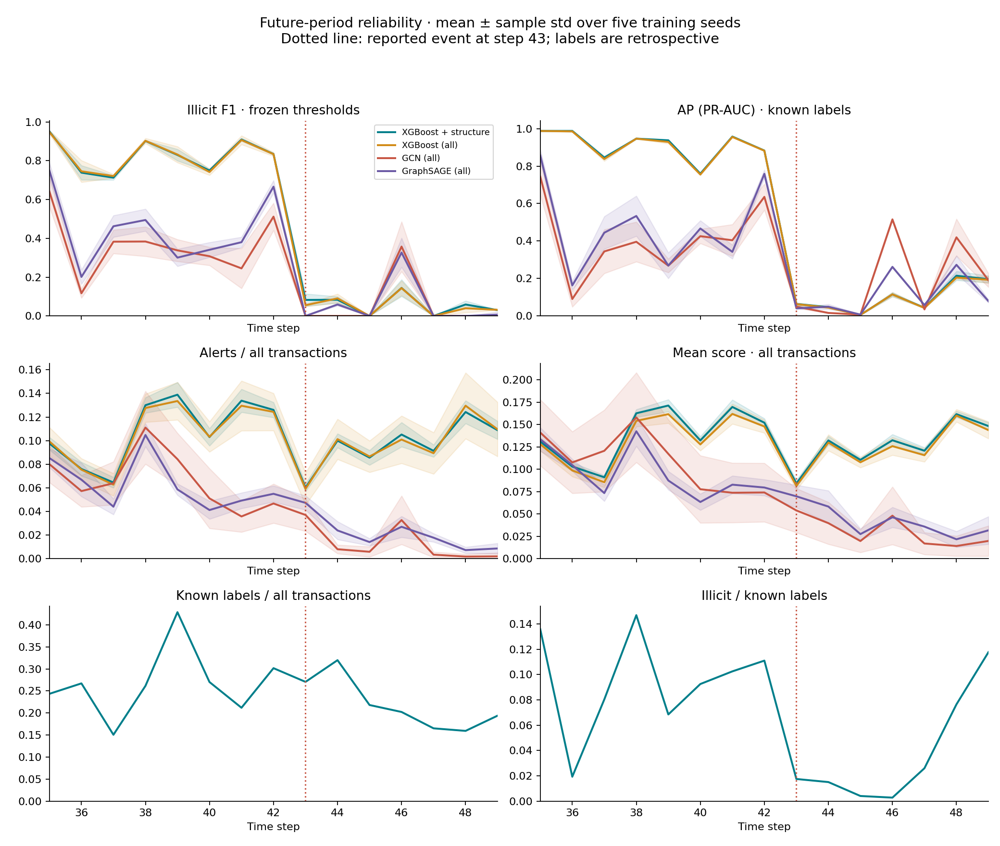
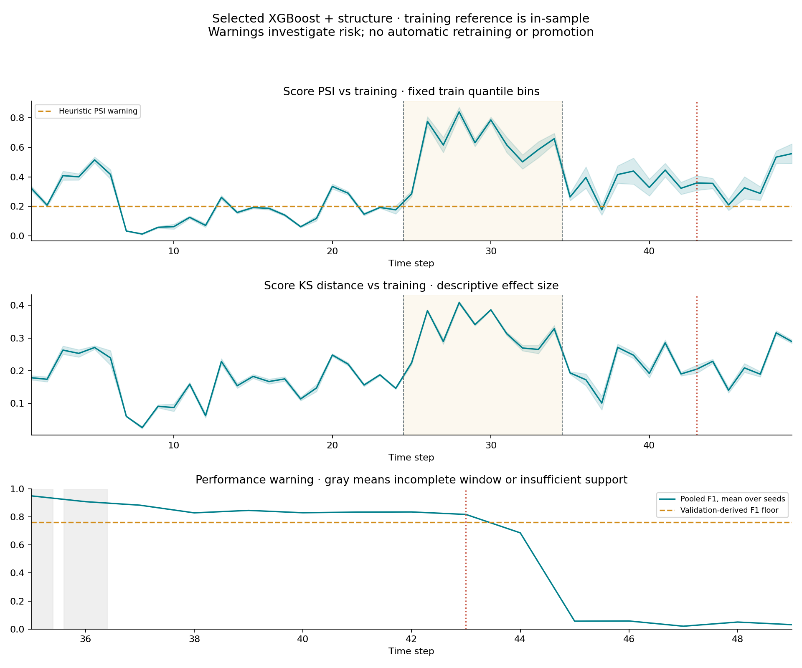
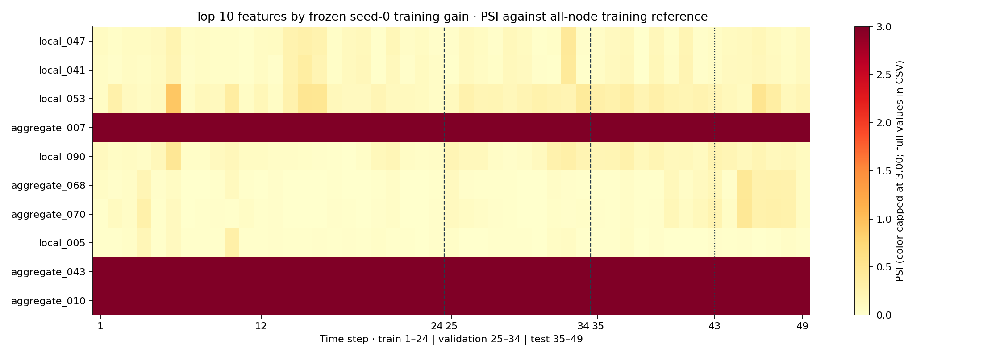

# Temporal reliability and drift monitoring

The model and each seed's decision threshold remain frozen. The selected candidate is **XGBoost
+ structure**, chosen from validation before Stage 5. This is retrospective monitoring of the
already-open test period, not a live alert evaluation.

## Measured performance around the reported event

| Model | Period | AP (PR-AUC) | Illicit F1 |
|---|---|---:|---:|
| XGBoost (all) | Steps 35–42 | 0.9066 ± 0.0019 | 0.8561 ± 0.0167 |
| XGBoost (all) | Steps 43–49 | 0.0417 ± 0.0012 | 0.0440 ± 0.0059 |
| XGBoost + structure | Steps 35–42 | 0.9084 ± 0.0021 | 0.8572 ± 0.0072 |
| XGBoost + structure | Steps 43–49 | 0.0431 ± 0.0023 | 0.0492 ± 0.0084 |
| GCN (all) | Steps 35–42 | 0.4177 ± 0.0727 | 0.4203 ± 0.0567 |
| GCN (all) | Steps 43–49 | 0.0477 ± 0.0061 | 0.0093 ± 0.0010 |
| GraphSAGE (all) | Steps 35–42 | 0.5301 ± 0.0497 | 0.5249 ± 0.0340 |
| GraphSAGE (all) | Steps 43–49 | 0.0344 ± 0.0024 | 0.0192 ± 0.0033 |

Periods are pooled transaction cohorts, not averages of time-step metrics. Mean ± sample std
covers seeds 0–4, not independent datasets. Support: before_event: 914 illicit / 9983 known labels; event_and_after: 169 illicit / 6687 known labels. Changing prevalence and
sparse labels affect AP and uncertainty.

## Drift and warning policy

All-node score and feature references use steps 1–24 only, including unknown nodes. Training
scores are in-sample predictions from the frozen models, so train-to-holdout differences mix
fitting optimism with temporal shift. Validation is shown as an out-of-time sanity check. PSI
uses 10 requested training quantile bins, collapsed
ties, open outer bins, and proportion flooring at
1e-06 followed by renormalization. Constant
references receive three bins. Exact cuts/counts are frozen in `frozen_reference.json`.

The PSI > 0.2 warning is a heuristic, not a universal
threshold. 100.0% of candidate validation
step/seed comparisons already exceed it. Seed 0's first test score warning is
step **35**, and its first persistent warning is
**36**. These are retrospective rule outputs, not
detection-latency estimates.

The performance warning pools the latest
3 test steps, requires at least
100 known and
20 illicit labels, and compares F1
with 80% of that
seed's saved validation F1. Incomplete windows
do not warn. Seed 0's first eligible performance warning is
**44**. The CSV records each seed's exact floor and support.

KS distance is a descriptive effect size. P-values are retained as diagnostics only:
transactions share graph structure, features/scores have ties, the reference model was fitted on
training labels, and repeated comparisons are not independent. No p-value triggers action. Drift
alone does not establish lower detection quality.

## Top 10 feature drift

Features are ranked once by the frozen representative model's training gain, with lexical name
ties. No held-out importance, labels or drift magnitude chooses them. Drift uses all nodes and
original released feature values, with no newly fitted scaler. Anonymous feature names limit
business interpretation. If time appears, its deterministic advance is expected and must not be
treated as a surprise failure.

## Investigation and retraining recommendation

1. A single PSI breach prompts input/pipeline and label-coverage checks. Two consecutive
breaches prompt investigation of persistent shift and targeted labeling.
2. A supported pooled-F1 breach prompts a retraining review using recent, adjudicated labels and
their actual availability times. Supervised warnings here use retrospectively available labels;
their online timing is unknown.
3. Train a challenger only after that review. Use a new chronological development window, choose
its threshold on validation under the real review budget, and test on a later untouched cohort.
Keep the existing candidate until the challenger passes quality/workload checks; no automatic
promotion is implemented.

This stage does not retrain a model or claim that retraining repairs the shift. The original
study associates step 43 with a dark-market shutdown and reports degradation even with its
repeated random-forest retraining. Our fixed periods investigate that reported boundary; this
dataset does not supply a causal counterfactual or identifiable event timestamps.

## Evidence and limits

`per_step_metrics.csv` / `.json` record known-label AP/F1, precision/recall, confusion counts,
all-node alert rate and mean score, label coverage and observed illicit prevalence. Unknown
labels never become false positives. `rolling_metrics.csv`, `score_drift.csv`,
`feature_drift.csv`, `warnings.csv` and the pooled `regime_*.csv` tables preserve denominators
and five-seed evidence. Original Stage 5 test scores are reused unchanged for all seven primary
variants; only the selected candidate receives train-referenced score/feature drift.

Completed-snapshot graph and forward-neighbor input availability remain retrospective. The
release lacks real label delays, entities, feature semantics and real-time deployment evidence.
Five training seeds quantify fitting variation, not temporal confidence intervals. These
warnings need prospective calibration on future adjudicated cohorts. README/About presentation
remains deferred for the next review.

Sources: [Weber et al., 2019, section 4, The Dark Market
Shutdown](https://arxiv.org/pdf/1908.02591); [SciPy two-sample KS
documentation](https://docs.scipy.org/doc/scipy/reference/generated/scipy.stats.ks_2samp.html).

<!-- measured-monitoring-interpretation -->
## What these findings mean

The selected candidate's pooled AP falls from **0.9084 ±
0.0021** in steps 35–42 to **0.0431 ±
0.0023** in steps 43–49. F1 falls from **0.8572 ±
0.0072** to **0.0492 ± 0.0084**. Post-event recall is
**4.6%**, so the frozen policy misses approximately
**95.4%** of known illicit transactions in that period.
Its all-node alert rate remains **9.3%**: investigation workload
continues while detection quality is poor. This is why a strong pooled test score does not
establish reliable operation over time.

Observed illicit prevalence among known labels changes from
9.16% to 2.53%.
That changes AP's baseline. ROC-AUC also drops from 0.969 to
0.692, and recall falls sharply, providing evidence beyond AP alone.
These are historical associations, not proof that the shutdown caused the change.

The PSI rule is already active in **100%** of validation step/seed
comparisons. It indicates distribution differences but does not isolate the step-43 failure.
The pooled-F1 rule first warns at step 44 for all 5 seeds in this recorded experiment.
Its three-step window initially dilutes the sharp step-43 decline; actual live warning timing
cannot be established without label-availability timestamps. The rule is an investigation and
retraining-review proposal, not an automatic retraining policy.

Training-only diagnostics find strongly time-associated features among the top ten:
**aggregate_007 (rho 0.989), aggregate_043 (rho 0.995), aggregate_010 (rho 0.993)**. Their drift is already substantial within training and during validation.
This explains why high feature PSI alone is not a shutdown-specific signal. Their anonymous
names do not establish their semantics. The earlier no-time ablation removes the explicit time
column only; it does not establish removal of implicit temporal information. A future follow-up
could test temporal-proxy ablations using a new chronological development/evaluation protocol.
No columns or models are changed after observing this test result.

`training_feature_diagnostics.csv`, `drift_warning_calibration.csv` and
`warning_timing_by_seed.csv` preserve these checks. No feature is selected by this diagnostic;
the monitored top ten remain those chosen by training-tree gain.
